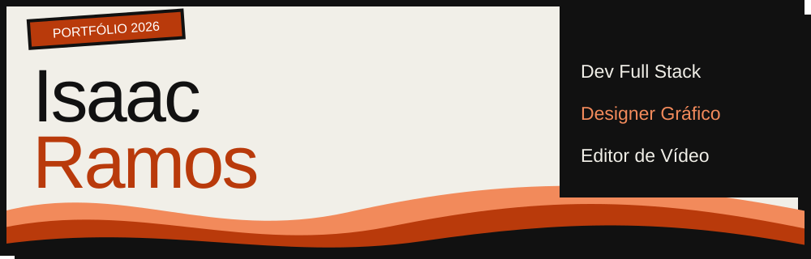
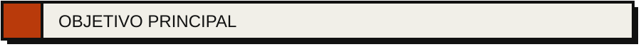
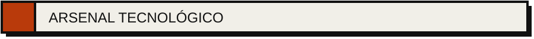
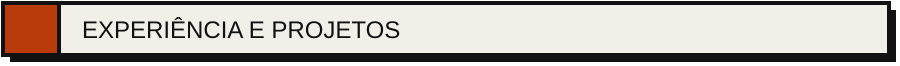
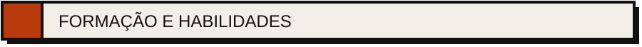
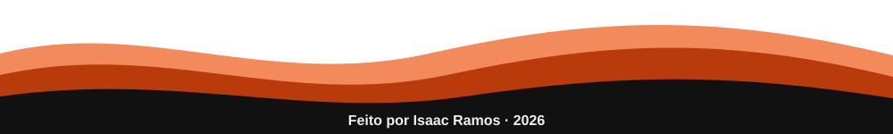

 

  

Estudante de Engenharia de Software que une lógica e estética. Quero criar soluções modernas e funcionais, onde o código resolve o problema e o design faz a pessoa querer usar.

 

  

 

  

 

### Portfólio Web
 

Site pessoal bilíngue (PT/EN), com tema claro e escuro, animações, linha do tempo e visualizador de certificados. Feito sem frameworks e publicado no GitHub Pages.

 

 

### Osprey Aerial Solutions · Fundador
  

Empresa própria de voo de drone: operação, captação de imagens aéreas, edição e gestão geral do negócio.

 

### Designer Gráfico e Editor de Vídeo Freelancer · 6 anos de experiência
  

Identidade visual, branding, design gráfico e edição de vídeo para clientes como Plano Imob, OKTA, Super Lab, Torklaw, Essencial e Igreja Núcleo da Fé.

 

### Game 2D · MK+ Academy
  

Formação completa em desenvolvimento de jogos 2D: game design, programação de mecânicas, animação de sprites, física e level design.

 

 

`[ ATIVO ]` Engenharia de Software | *UniCEUB*  
`[ CONCLUÍDO ]` CS50 Harvard no Brasil | *Fundação Estudar*  
`[ CONCLUÍDO ]` Python Básico | *Fundação Bradesco*  
`[ CONCLUÍDO ]` Python | *Santander*  
`[ CONCLUÍDO ]` Jornada Python | *Hashtag Treinamentos*  
`[ CONCLUÍDO ]` DevArt: Um Novo Dia | *Design, Front End e IA*  
`[ CONCLUÍDO ]` Game 2D | *MK+ Academy*  
`[ EM ANDAMENTO ]` Inglês | *Centro Interescolar de Línguas*

 

  

